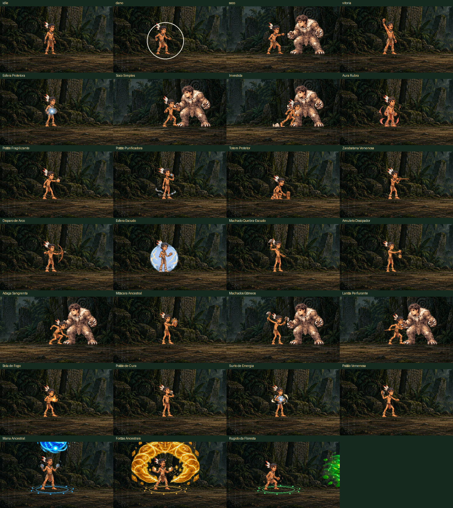
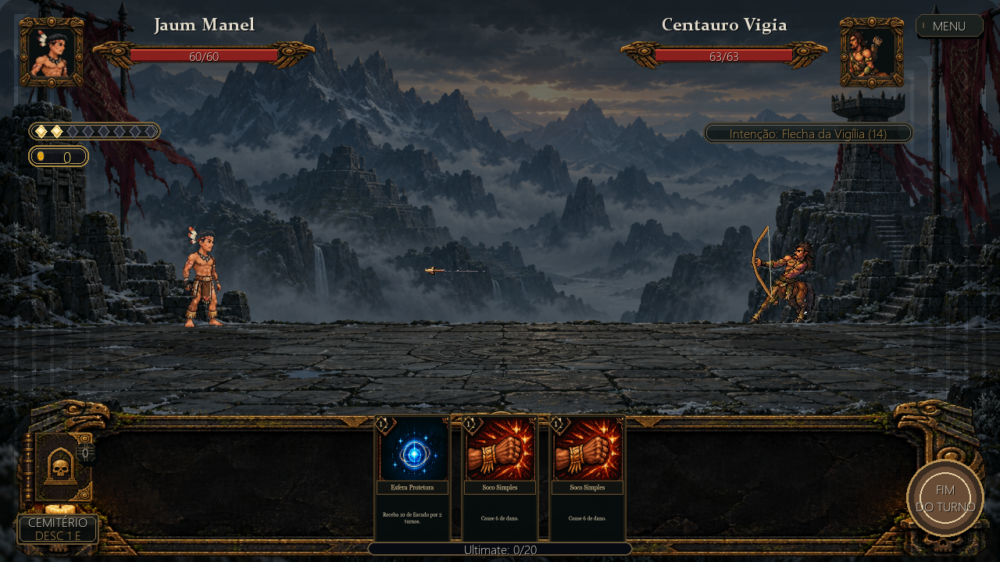
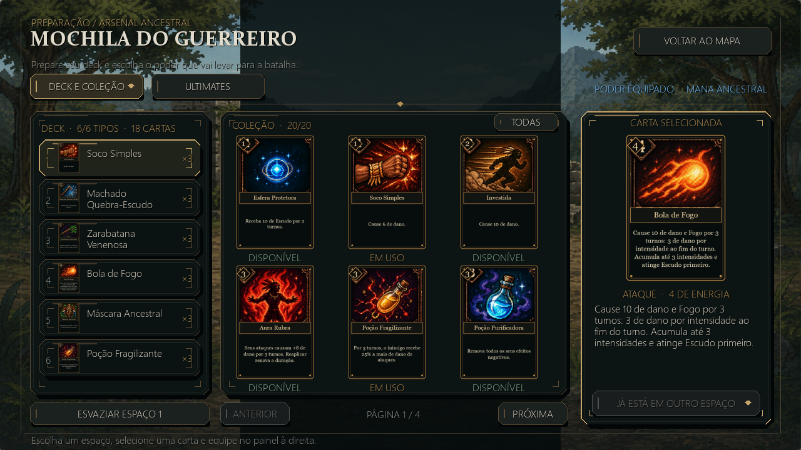
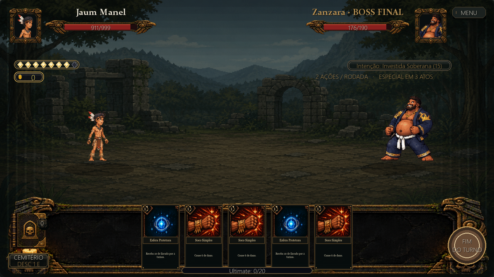

# Scape From Stone de Cut

**A floresta resiste. Escreva sua estratégia. Defenda sua terra.**


## Sobre o jogo

*Scape From Stone de Cut* é um jogo de **estratégia, roguelike, RPG de turno e deckbuilding** para PC, com classificação indicativa a partir de 10 anos.

Foi criado para a disciplina de Programação Para Jogos na universidade, com o objetivo de aplicar, na prática, os conceitos fundamentais do desenvolvimento de jogos usando Python e Pygame: ciclo principal, cenas, estados, entrada, interface, saves e build. A proposta de design é simples de explicar e difícil de dominar: **pouca ação por turno, muita consequência por escolha**.

## História

Jaum Manel, jovem indígena da aldeia Stone The Cut, vê sua terra invadida pelo Clã Moskar e sua tribo capturada pelo líder Zanzara. Sozinho e sem exército, ele atravessa o próprio território ocupado, vence combates por turnos, monta seu baralho carta a carta e marcha rumo ao Santuário de Pedra para libertar seu povo.

## Capturas de tela

| | |
|---|---|
|  |  |
|  |  |

## Como jogar

**Controles (exclusivamente mouse):**

| Ação | Comando |
|---|---|
| Selecionar cartas, botões e menus | Botão esquerdo |
| Voltar / cancelar | `Esc` |
| Jogar no menu principal | `Enter` ou `Espaço` |
| Cemitério | `C` |
| Tela cheia / janela | `F11` |
| Maior janela 16:9 / janela 1280×720 | `F10` |
| Reiniciar após a derrota | `R` |
| Laboratório de testes (na seleção de saves) | `T` |

**Um combate, em resumo:**

1. No seu turno, a energia é restaurada e a mão é completada; você joga cartas gastando energia. A mão vai de 3 a até 5 cartas ao longo do combate (a energia máxima também cresce, de 2 até 8).
2. A intenção do inimigo (atacante, defesa, valor) fica visível na HUD, então cada rodada é um quebra-cabeça de bloqueio e dano.
3. Ao encerrar o turno, a mão restante é descartada e o inimigo age. Escudo (bloqueio) absorve dano antes da vida.
4. Quando a vida do oponente chega a zero, a fase é vencida e você escolhe a recompensa.
5. Se a vida de Jaum Manel zerar, a run volta ao último checkpoint (tecla `R`).

## Principais mecânicas

- **Baralho com três pilhas:** compra, mão e descarte. Se a pilha de compra esvazia, o descarte é reembaralhado.
- **20 cartas únicas** (ataques, habilidades e poderes), com artes e animações próprias; as recompensas são sorteadas entre as que você ainda não possui.
- **Cemitério:** descarte uma carta da mão por 1 de energia, ou faça 1 troca grátis por turno com uma carta do descarte.
- **Ultimates:** uma barra de carga (20 pontos, alimentada pela energia gasta em cartas) destrava uma das três Ultimates — **Mana Ancestral**, **Forças Ancestrais** ou **Rugido da Floresta**.
- **Moedas** ganhas em combate servem para a **loja "Mercado Silencioso"** (cura de +15 HP por 50 moedas, até 3 por run, e cartas do catálogo).
- **Mochila:** monte seu deck com até 6 tipos de carta (3 cópias de cada) e escolha a Ultimate equipada.
- **Tutorial guiado:** primeiro acesso a um save ensina as regras com balões e textos na tela.
- **Saves em 3 slots** (e um laboratório de testes via `T`): progresso, coleção, moedas e ultimates persistem entre sessões.
- **Recuperação de vida entre lutas:** o balanceamento da cura pós-combate é ponto de atenção do projeto; a regra definitiva (vida persistindo entre combates, com cura apenas após chefes de território) está em evolução — veja [Em desenvolvimento](#estado-atual-e-roadmap).

## Progressão

O jogo tem uma campanha linear de **sete territórios**. Em cada um, há 2 combates comuns antes do chefe; concluir o chefe desbloqueia o próximo território.

| # | Território | Chefe |
|---|---|---|
| 1 | Pedra do Corte | Guardião da Pedra |
| 2 | Mata Sombria | Álvaro e Tex |
| 3 | Ruínas Ancestrais | Goblin Nerd |
| 4 | Pântano Abissal | Gordofera |
| 5 | Fortaleza Caída | Corpo Seco |
| 6 | Pico da Vigília | Carrasco da Vigília |
| 7 | Santuário de Pedra | Zanzara (boss final) |

## Instalação e execução

Pré-requisitos: **Python 3.12 ou mais recente**. As dependências vêm do `requirements.txt` (somente Pygame).

```bash
git clone https://github.com/CyberSafe-Games/Scape-from-stone-de-cut.git
cd Scape-from-stone-de-cut

# Em Linux/macOS, o launcher pode ser `python3` em vez de `python`
python3 -m pip install -r requirements.txt
python3 main.py
```

O jogo abre em uma janela de 1280×720 com renderização interna de 1920×1080. Use `F11` para alternar tela cheia e `F10` para escolher um tamanho de janela maior ou o padrão.

## Testes

A suíte usa `unittest` (não pytest). Como há muitos assets, os testes headless pedem os drivers dummy do SDL:

```bash
# Suíte completa (pesada, pode passar de 5 minutos)
SDL_VIDEODRIVER=dummy SDL_AUDIODRIVER=dummy python3 -m unittest discover -s tests -t .

# Um módulo específico
SDL_VIDEODRIVER=dummy SDL_AUDIODRIVER=dummy python3 -m unittest tests.test_tactical_cards -v
```

Existe um laboratório de testes dentro do jogo: na tela de seleção de saves, pressione `T` para abrir o Laboratório de Testes (vida infinita e tudo desbloqueado).

## Estrutura do projeto

```text
main.py                 # Ponto de entrada do jogo
src/config/             # Resolução, FPS, caminhos, paleta, layout
src/core/               # Janela, gerenciador de cenas, assets, áudio
src/scenes/             # Menu, seleção de saves, tutorial, mapa, batalha, mochila, loja, modais
src/systems/            # Regras de jogo sem interface: combate, saves, campanha, cartas, inimigos, loja
src/models/             # Entidades (jogador, inimigos, cartas, efeitos, ultimates)
src/ui/                 # HUD, cartas, sprites animados e helpers de desenho
assets/                 # Sprites, efeitos, cartas e áudio
docs/                   # Documentos e prévias de arte/animação
devtools/               # Scripts de preparo/preview de sprites (uso interno)
tests/                  # Suíte de testes (unittest)
saves/                  # Saves locais dos jogadores (ignorado pelo git)
```

## Estado atual e roadmap

**Em funcionamento hoje:** combate por turnos, baralho e pilhas, energia, intenção do inimigo, bloqueio, 20 cartas com efeitos, Cemitério, as três Ultimates, moedas e recompensas, os 7 territórios com seus chefes, Mochila, Loja, tutorial guiado, seleção de saves com 3 slots, tela de Game Over in-battle, efeitos de áudio para UI e ataques, sprites animados (12 frames para jogador e chefes; 8 para inimigos comuns).

**Em desenvolvimento (ainda não implementado):**

- Introdução em quadrinhos e a sequência de encerramento ao derrotar Zanzara;
- Música de fundo (hoje há efeitos sonoros; não há trilha);
- Upgrades de vida e de energia máxima na loja;
- Comportamento de Zanzara mudando conforme a vida diminui;
- Regra de cura definitiva: vida persistindo entre combates, com recuperação de 30% da vida máxima apenas após chefes de território;
- Permadeath (reset total da run) conforme previsto no design — hoje o último checkpoint é mantido ao morrer;
- Polimento e balanceamento finais.

**Cronograma da equipe (2026):** sprints semanais de 23/09 a 24/11; apresentação parcial em 28/10 e final em 25/11.

## Equipe CyberGames

Projeto acadêmico da disciplina de Programação Para Jogos — Barbacena, 2026.
Orientação do professor Rodrigo Fernandes dos Santos.

- Gabriel Augusto — mecânicas
- João Pedro de Almeida Melo — mecânicas
- Otávio Henrique Nézio Melo — mecânicas
- José Gabriel Mazoni Val — testes das versões
- João Emanuel de Faria — cartas e história
- Lucas Evaristo Almeida de Paula — inimigos
- Marcus Tadeu de Oliveira Souza — som

As decisões de escopo, identidade visual e mecânicas são tomadas e avaliadas pela equipe; a IA é apoio de produção, não autora do design.

## Uso de Inteligência Artificial

A IA foi usada como ferramenta de apoio na criação e aceleração dos sprites e no desenvolvimento de algumas mecânicas, com direção e revisão humana. Todas as decisões de escopo, identidade visual e mecânicas são responsabilidade da equipe; os sprites gerados por IA seguem paleta e referências aprovadas.

## Licença

<!-- TODO: definir licença -->
