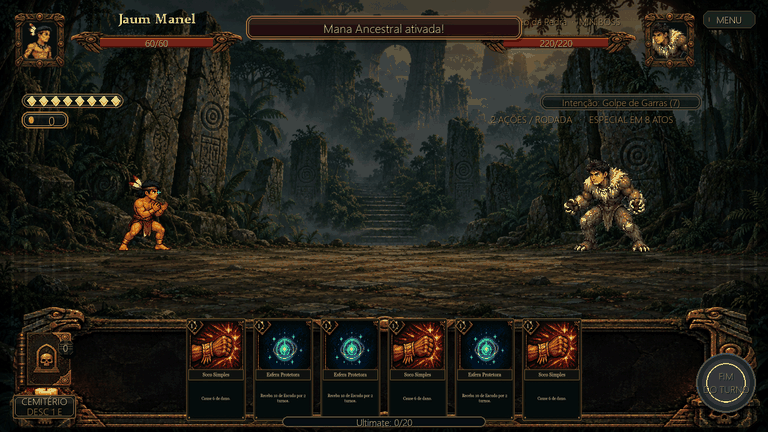
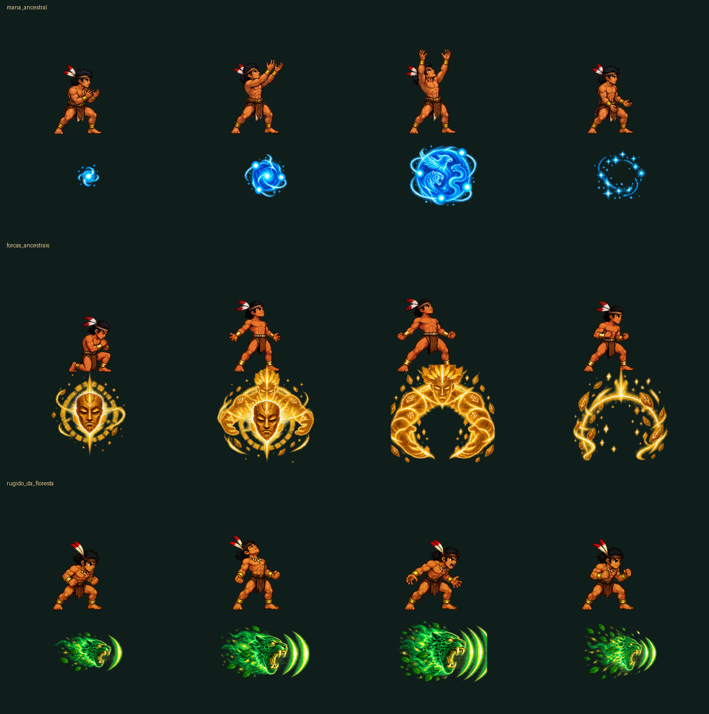

# Animações das ultimates

As três habilidades agora usam poses próprias do guerreiro, voltadas para a
direita, e efeitos independentes com transparência real. São **24 sprites**:
quatro poses e quatro efeitos para cada ultimate, além das três folhas originais.

| Ultimate | Duração | Animação |
|---|---|---|
| Mana Ancestral | 2,2 s | Reúne energia, ergue as mãos, sustenta uma esfera azul com espíritos e a dissolve em estrelas. |
| Forças Ancestrais | 2,4 s | Ajoelha, abre os braços e invoca um guardião dourado que envolve o personagem e se dissipa. |
| Rugido da Floresta | 2,5 s | Inspira, ruge e lança uma onça espiritual verde com ondas sonoras até o inimigo. |

Selos no chão, partículas, variações de escala e transparência dão continuidade
entre as poses. As camadas traseira e dianteira permitem que o espírito envolva
o guerreiro sem redimensionar seu corpo. O pivô fica fixo nos pés.

No Rugido, a onda sai em 38% da animação e chega em 78%. O brilho de dano,
os números flutuantes e as moedas da vitória acompanham esse impacto.
A vida e o Escudo exibidos no retrato inimigo permanecem anteriores ao golpe
até a onda chegar. As regras de combate continuam sendo resolvidas pelo motor;
a apresentação visual espera a animação. A tela de recompensa aguarda o fim do cast.

Na Mana e nas Forças, os textos dos benefícios aparecem no auge da magia,
sem sobrepor os dois números no mesmo ponto. Ao terminar, os efeitos somem e
o personagem retorna à animação normal. O tutorial herda a mesma implementação.

## Arquivos

- `assets/ultimate_effects/mana_ancestral/`: `cast_1.png` a `cast_4.png`, `effect_1.png` a `effect_4.png`, `source.png`.
- `assets/ultimate_effects/forcas_ancestrais/`: os mesmos nove arquivos.
- `assets/ultimate_effects/rugido_da_floresta/`: os mesmos nove arquivos.
- As poses usam canvas 320 × 260; os efeitos usam 384 × 320.
- `src/systems/ultimate_animations.py` centraliza os tempos e os pontos de impacto.
- `src/ui/ultimate_fx.py` desenha os efeitos em camadas e o projétil espiritual.
- `devtools/prepare_ultimate_animations.py` refaz os recortes das folhas RGBA.
- `devtools/preview_ultimate_animations.py` renderiza as três habilidades na cena
  real, sem acessar saves do jogador, e exporta PNGs e a prévia GIF.

A geração utilizou a **ferramenta integrada de imagens**, uma chamada para cada
folha. Os prompts completos estão abaixo. Os recortes mantêm o canal alfa;
não há fundo branco ou quadriculado incorporado aos sprites.

## Verificação

Testes cobrem carregamento dos 24 sprites, transparência, pivô, posição fixa,
sequência de poses, camadas, área de desenho, limpeza ao terminar, movimento
do projétil, sincronização do impacto, benefício visual e vitória por golpe fatal.
As três animações também foram renderizadas e inspecionadas em combate.

## Prompt — Mana Ancestral

Create a production-ready 2D game animation sprite sheet for MANA ANCESTRAL. Genuine transparent RGBA background, no checkerboard, no scene, no floor, no shadows outside sprites, no writing, no labels, no borders. Wide canvas with exactly FOUR equal columns and TWO equal rows: 8 separate sprites in an evenly spaced 4x2 grid, generous transparent gutters, each sprite entirely inside its own cell. TOP ROW: exactly four full-body casting poses of the SAME game hero from the visible small existing game sprite: young tan/brown-skinned warrior, compact black hair, black headband with two red/white feathers, bare muscular chest, brown loincloth, gold wrist/ankle bands, bare feet. All four face RIGHT in three-quarter side view, feet on the SAME baseline, same body proportions, same scale, no mirroring. Pixel art with crisp dark outlines, warm brown skin palette matching the small existing sprite; NOT the long-haired detailed card illustration proportions. Pose 1: slight crouch gathering power in both palms near chest. Pose 2: both hands rising overhead. Pose 3: arms fully raised holding an invisible large sphere above head, gaze upward. Pose 4: lowering arms and relaxing after the spell. Keep the TOP ROW CHARACTER POSES free of any floating orb, surrounding aura or other large magical effect, to allow game engine layering. BOTTOM ROW: four separate MAGIC EFFECT sprites ONLY, NO human, NO hand, NO skin, NO ground: frame 1 small cyan energy seed with tiny orbit; frame 2 medium luminous sapphire sphere with three orbiting sparks and lightning; frame 3 full large ancestral blue energy sphere with faint eagle/jaguar/serpent spirit motifs inside and luminous orbiting rings; frame 4 the blue sphere dispersing into a ring of cyan star particles. Effects centered within their cells, same effect anchor and consistent maximum scale; soft transparent cyan halo, rich saturated blue center, readable pixel shapes. Match the new blue Mana Ancestral card and the game's pixel-art style. Top-row body should occupy about 55 percent of cell height, with arms raising to at most 80 percent; leave at least 10 percent clear padding on all edges. No sprite touching or crossing a grid boundary.

## Prompt — Forças Ancestrais

Create a production-ready PIXEL ART 2D game animation sprite sheet for FORÇAS ANCESTRAIS, a golden strength/protection ultimate. Genuine transparent RGBA background, no checkerboard, no scene, no floor, no external shadow, no text, no labels, no grid lines or frame. Wide canvas divided into exactly FOUR equal columns and TWO equal rows, eight separate complete sprites in an evenly spaced 4x2 grid with generous transparent gutters. TOP ROW: four full-body poses of the SAME small game hero visible in the provided game sprite: young tan/brown-skinned warrior, compact black hair, black headband with two red/white feathers, bare muscular chest, brown loincloth, gold wrist and ankle bands, bare feet. Consistent compact pixel-art body proportions matching the existing game sprite, crisp black-brown outlines, warm brown skin. All four face RIGHT in three-quarter side view; feet fixed to the same baseline, body same scale. Pose 1 kneeling slightly with fists pressed together near chest, pose 2 straightening up with arms beginning to spread, pose 3 powerful wide stance with clenched fists extended down and outward and chest raised, pose 4 relaxed fighting stance recovering from the cast. TOP ROW contains ONLY the hero, no aura or spirit or large magic effect. BOTTOM ROW contains four independent GOLDEN MAGIC EFFECT sprites ONLY, no ordinary human or skin: frame 1 ancient luminous wooden mask surrounded by a small amber runic ring; frame 2 the same mask with a larger amber halo and the upper silhouette of a spectral guardian forming behind it; frame 3 imposing golden ancestral guardian spirit with mask-like face, broad shoulders and enormous protective arms curving outward around an empty transparent central opening where the living hero can be drawn separately; frame 4 guardian fading into a golden protective arch, star particles and fragments of runic light. Guardian hologram is entirely gold/amber light, dark gold details and partial transparency, not solid flesh. The four magic effect sprites share a stable center and maximum canvas scale, all entirely inside own cell, no touching neighboring sprites. Legible silhouettes and pixel-shaded luminous effects, match the new golden Forças Ancestrais card, majestic but game-ready. At least 10 percent transparent padding around each sprite.

## Prompt — Rugido da Floresta

Create a production-ready PIXEL ART 2D game animation sprite sheet for RUGIDO DA FLORESTA, an emerald spiritual jaguar roar ultimate. Genuine transparent RGBA background, no checkerboard, no scene or floor, no shadow outside sprites, no writing, no labels, no frame, no grid lines. Wide canvas with exactly FOUR equal columns and TWO equal rows: eight separate complete sprites in a regular 4x2 grid, generous transparent gutters. TOP ROW: four full-body cast poses of the SAME compact game hero visible in the small existing game sprite: young tan/brown-skinned warrior, compact black hair, black headband with two red/white feathers, bare muscular chest, brown loincloth, gold wrist and ankle ornaments, bare feet. Match existing sprite proportions and pixel art style with crisp dark outlines and warm skin colors; NOT elongated painterly card-art body. All poses face RIGHT, feet on the same baseline, same body scale and proportions. Pose 1 knees bent, fists close to waist, taking a deep breath; pose 2 head tilted slightly back, chest filling, fists clenched; pose 3 leaning forward and unleashing a ferocious roar toward RIGHT, mouth open, arms down and outward; pose 4 settling back into the right-facing fighting stance. TOP ROW contains only the hero, no large aura or animal or wave, because effects are layered in the game. BOTTOM ROW: four magical PROJECTILE EFFECT sprites ONLY, NO human, NO skin, NO ground: a spectral emerald JAGUAR HEAD in clear SIDE PROFILE facing RIGHT, with golden eyes, golden fangs, open roaring jaws, crisp pixel-shaded green spectral fur and transparent trailing vapor flowing LEFT. Frame 1 small forming jaguar head and one green sonic crescent; frame 2 full recognizable jaguar spirit head with two sonic crescents ahead to the RIGHT; frame 3 powerful full head with wide jaws and three bright emerald/gold sonic rings ahead, green vapor trailing left; frame 4 dissipating head into green sonic arcs, small leaves and golden sparks. No whole animal body. Same head orientation in all four, stable head center, all sprites contained inside their cells with at least 10 percent padding. Large readable magical shapes and majestic ultimate energy, matching the new green Rugido da Floresta card.
