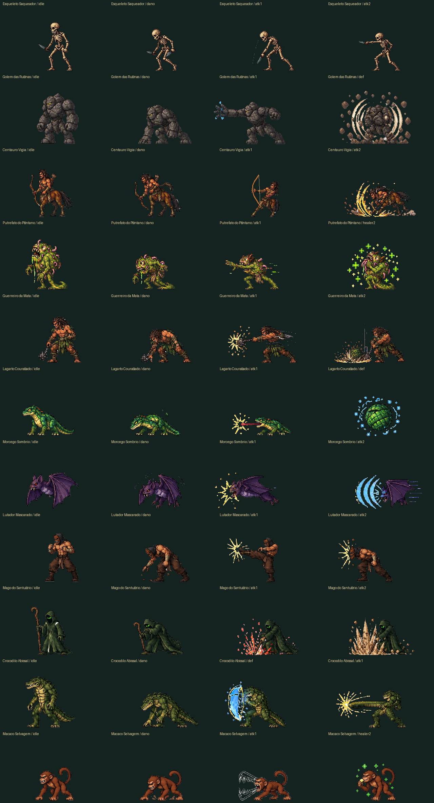

# Habitantes dos encontros do caminho

Os 11 novos inimigos se somam a Slime e Vinimuth. A distribuição possui
**1 / 2 / 2 / 2 / 2 / 2 / 2 tipos**, sem alterar as lutas principais dos territórios.
Cada um dos três encontros de um bioma sorteia apenas entre seus habitantes.

| Bioma | Inimigos comuns | Relação com a região |
|---|---|---|
| Pedra do Corte | Slime | Introdução simples antes do Guardião da Pedra. |
| Mata Sombria | Macaco Selvagem, Guerreiro da Mata | Fauna e combatente da floresta. Chefe exclusivo em desenvolvimento. |
| Ruínas Ancestrais | Golem das Ruínas, Lagarto Couraçado | Habitantes das ruínas onde o Goblin Nerd reaproveita artefatos antigos. |
| Pântano Abissal | Putrefato do Pântano, Crocodilo Abissal | Parasitas, veneno e réptil das águas profundas. |
| Fortaleza Caída | Esqueleto Saqueador, Morcego Sombrio | Mortos e criaturas noturnas no domínio do Corpo Seco. |
| Pico da Vigília | Centauro Vigia, Lutador Mascarado | Patrulheiros e combatentes da passagem do Carrasco da Vigília. |
| Santuário de Pedra | Vinimuth, Mago do Santuário | Defensores místicos do último território. |

## Combate e arte

- 176 quadros separados, com fundo transparente, orientação à esquerda,
  escala fixa por personagem e apoio no chão. O quarto idle do Lutador já
  estava invertido na referência e recebeu tratamento individual.
- Seis projéteis separados: rocha arcana, flecha, cuspe parasita, onda sônica
  e dois disparos do Mago. Lançamento, movimento e impacto têm tempos próprios;
  o atirador permanece em sua posição. Quadros da referência que continham
  apenas efeitos recebem também uma pose do personagem.
- Golem e répteis usam escudo; Macaco e Putrefato recuperam vida;
  Esqueleto e Morcego aplicam sangramento; Putrefato aplica veneno;
  Mago aplica fogo. Usam as regras e indicadores de estado existentes.
- O escudo continua durando duas rodadas completas. Os chefes, cartas,
  ultimates e saves existentes mantêm suas regras.
- O Morcego paira e bate as asas. Os demais novos habitantes usam respiração
  discreta sobre uma pose estável para evitar mudanças bruscas no idle.

As imagens prontas ficam em `assets/enemies/`. Não é preciso instalar ferramentas
de imagem para jogar. `devtools/prepare_normal_enemies.py PASTA` permite refazer
os recortes a partir das onze imagens de referência com seus nomes originais.

Para testar todos os biomas, entre no Laboratório de Testes e repita os encontros
do caminho. Os nomes dos habitantes aparecem no painel do mapa.

