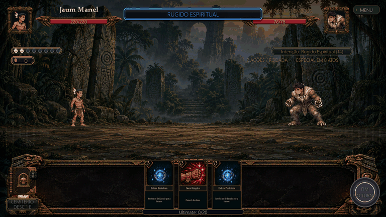
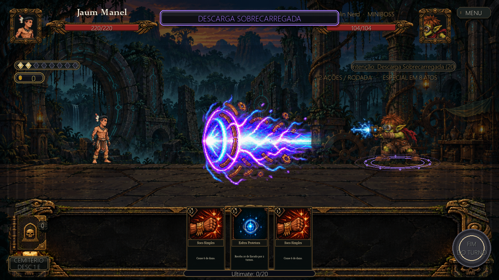

# Ultimates dos chefes e Ruínas Ancestrais

Os quatro minibosses territoriais existentes têm animações exclusivas,
com **o design original dos personagens**: rosto, cabelo, roupa, proporções e
armas vêm das próprias sprites já usadas nas lutas normais. Cada um tem quatro poses e quatro efeitos
independentes: **32 sprites RGBA**, além das quatro folhas originais.
Todos os chefes e projéteis estão orientados para a esquerda.

| Chefe | Especial | Animação | Duração |
|---|---|---|---|
| Guardião da Pedra | Rugido Espiritual | Concentra poder nas garras e libera um urso azul com runas e fragmentos de pedra. | 2,6 s |
| Goblin Nerd | Descarga Sobrecarregada | Prepara sua arma original e dispara uma carga violeta/ciano com faíscas e engrenagens. | 2,4 s |
| Corpo Seco | Ataque Giratório | Prepara as adagas originais, avança e executa um giro envolvido por uma tempestade de lâminas espectrais. | 2,5 s |
| Carrasco da Vigília | Execução Escarlate | Canaliza a estrela vermelha, ergue o machado, salta e golpeia com uma explosão escarlate. | 2,8 s |

## Integração

O especial continua acontecendo no 8º, 16º e demais múltiplos de oito atos.
Os danos e os custos permanecem os mesmos. O evento de ataque identifica
explicitamente quando a ação escolhida é a ultimate, separando os novos
quadros dos ataques comuns, inclusive da descarga comum `atk2` do Goblin.

O corpo mantém a escala dos sprites originais, sem redesenho ou aumento de armas.
`BOSS_ORIGINAL_CASTS` escolhe as poses de preparação, ataque e recuperação dessas
animações. O carregamento usa diretamente os desenhos originais e adiciona
apenas espaço transparente no canvas. Pequenos fragmentos de células vizinhas
dos recortes antigos do Goblin são descartados; os pixels do personagem ficam intactos.
Como o disparo antigo do Goblin vinha de uma folha em escala menor, sua altura
é alinhada à pose original em idle com escala de pixels, preservando as cores,
o rosto e a arma. Os pés permanecem no mesmo ponto entre as poses.
Os efeitos, trajetórias, saltos e tempos aprovados são preservados. Os efeitos são
desenhados em camadas, com selos no chão, partículas, voo ou deslocamento e
dissipação. O Guardião e o Goblin disparam de sua posição; o Corpo Seco avança
para golpear; o Carrasco também ganha elevação durante o salto.

No impacto são liberados o brilho, os números de dano e a atualização visual
da vida e do Escudo do jogador. A lógica do motor resolve a ação normalmente;
a apresentação guarda uma cópia do estado anterior apenas até a chegada do
golpe. O próximo ato do chefe aguarda o fim da animação e a tela de derrota
aguarda a conclusão do especial, inclusive em golpes fatais.

As animações das ultimates do jogador, os ataques comuns e o Vigor Escarlate
com estrela vermelha continuam utilizando seus fluxos próprios.

## Cenário do Goblin Nerd

O encontro continua nas **Ruínas Ancestrais, fase 3**. O novo cenário combina
ruínas de pedra, portal circular, inscrições ciano, bronze envelhecido,
engrenagens e uma oficina improvisada ao fundo. A plataforma aberta tem o
horizonte alinhado à altura dos pés dos combatentes.

O fundo é aplicado aos encontros comuns e ao chefe da fase 3, incluindo
repetições feitas a partir de saves existentes. Os territórios que ainda
estão recebendo chefes próprios não tiveram novos personagens inventados.

## Arquivos finais

- `assets/background_ruinas_ancestrais.png`: cenário opaco, ajustado pelo jogo
  à resolução virtual 1280 × 720.
- `assets/boss_ultimate_effects/guardiao_da_pedra/`.
- `assets/boss_ultimate_effects/goblin_nerd/`.
- `assets/boss_ultimate_effects/corpo_seco/`.
- `assets/boss_ultimate_effects/carrasco_da_vigilia/`.

Cada pasta contém `source.png`, `cast_1.png` a `cast_4.png` e `effect_1.png`
a `effect_4.png`. As poses usam canvas 448 × 320 e os efeitos 384 × 320,
com fundo transparente. `cast_*.png` são exportações das poses originais para
revisão. O jogo também as monta diretamente dos assets originais ao carregar.
Somente a parte dos efeitos de `source.png` é usada; seus personagens gerados
ficam como histórico e não são exibidos no jogo.

`src/systems/boss_ultimate_animations.py` centraliza os tempos e o movimento;
`src/ui/boss_ultimate_fx.py` desenha as camadas.
`devtools/prepare_boss_ultimates.py` exporta as poses originais e preserva os
efeitos prontos. A opção `--effects` permite refazer apenas os recortes dos efeitos.
`devtools/preview_boss_ultimates.py` exporta as prévias na cena real sem ler
ou alterar saves do jogador.

## Geração e verificação

Foi utilizada a ferramenta integrada de geração de imagens: uma chamada por
folha e uma para o cenário, mais uma edição corretiva do machado.
Os prompts completos dessa geração anterior estão em [prompts_bosses_e_ruinas.json](prompts_bosses_e_ruinas.json).
A restauração do design reutiliza os arquivos originais, sem gerar novos rostos.

Os testes verificam os 32 quadros, transparência e pivô, frequência do especial,
separação do tiro comum do Goblin, deslocamento e direção dos projéteis,
sincronização de vida/Escudo e brilho, camadas e limpeza dos efeitos,
sequência de ações, golpe fatal e aplicação do fundo da fase 3.
As quatro animações também foram renderizadas e inspecionadas em combate.
Há verificações específicas da correspondência com os pixels/cores das sprites
originais e das assinaturas dos 16 efeitos aprovados, garantindo que a restauração
do personagem não substitua a arte da magia.

