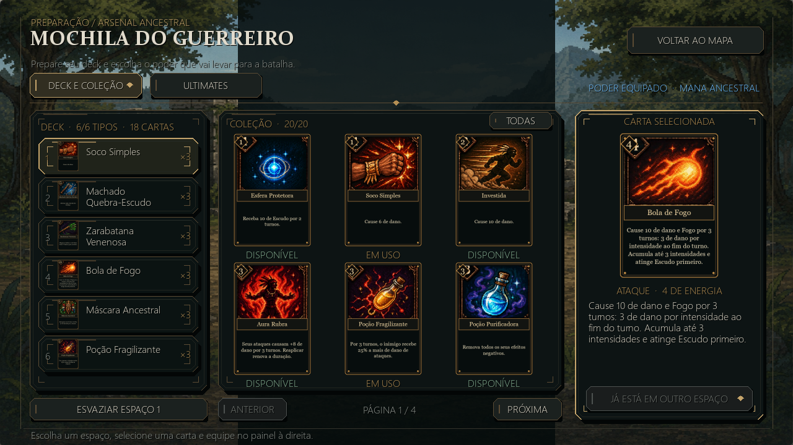
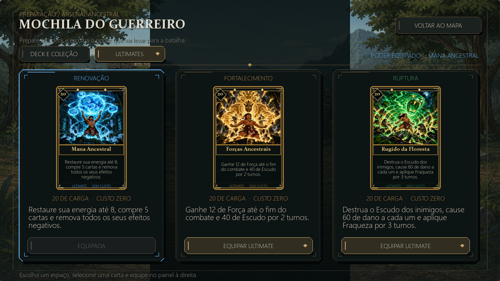
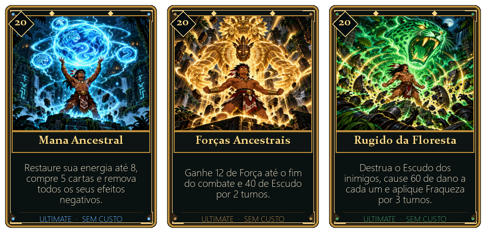

# Mochila e ultimates

A preparação tem duas abas: **Deck e coleção** e **Ultimates**. Ambas seguem
as molduras de bronze, pedra escura e tipografia das outras telas do jogo.

## Como usar

1. No mapa, abra a mochila pelo botão ou pela tecla B.
2. Escolha um dos seis espaços de deck e uma carta da coleção. A prévia à direita
   mostra a descrição completa; o botão Equipar confirma a escolha.
3. Cada espaço fornece três cópias do tipo escolhido. Tipos não se repetem em
   espaços diferentes, e pelo menos um precisa continuar ocupado.
4. Use as setas, a roda do mouse ou Anterior/Próxima para navegar pela coleção.
   O filtro Obtidas mostra apenas o que já está disponível no save.
5. Na aba Ultimates, equipe uma das três habilidades. A troca não usa moedas,
   não ocupa espaço do deck e preserva a carga acumulada.

TAB alterna as abas; 1–6 escolhem o espaço; Enter equipa a carta selecionada;
ESC volta ao mapa. As alterações são salvas ao confirmar cada escolha.

As três ultimates estão disponíveis desde a preparação. Saves antigos também
recebem as opções ao carregar, mantendo a habilidade equipada e o progresso.
Não havia uma regra de desbloqueio das alternativas na campanha anterior.

## Balanceamento

Todas exigem **20 de carga**, acumulada ao gastar energia em cartas, e não
custam energia para ativar. Quando prontas, aparecem na mão com moldura dourada.

| Ultimate | Antes | Agora | Papel |
|---|---|---|---|
| Mana Ancestral | Restaurava até a energia máxima e comprava 3 cartas | Energia atual sobe para 8, compra até 5 cartas e remove efeitos negativos | Renovar a mão e permitir uma sequência forte de ações |
| Forças Ancestrais | 4 de Força e 15 de Escudo | 12 de Força até o fim do combate e 40 de Escudo por 2 turnos | Crescimento ofensivo com proteção imediata |
| Rugido da Floresta | 12 de dano e 2 ações de Fraqueza | Destrói Escudo, causa 60 de dano por alvo e aplica Fraqueza por 3 rodadas completas | Romper defesas e reduzir a pressão do inimigo |

A Mana não aumenta a energia máxima permanente e não cria cartas quando as
pilhas se esgotam; o texto flutuante informa a quantidade realmente comprada.
A purificação preserva Escudo e efeitos positivos. A Força termina com o combate.
O Rugido considera Força, Aura Rubra e Fragilidade; o Totem ainda protege seu
próximo ataque. Fraqueza reduz o dano base dos ataques em 25% e sua duração só
avança após a rodada completa do chefe, abrangendo os dois atos.

Os valores diferenciam as ultimates das cartas comuns atuais: Machados Gêmeos
causa 40 por 4 de energia, Aura Rubra concede +8 temporários e Esfera Escudo dá
30 de proteção. O balanceamento foi validado em testes de regras; partidas com
o grupo continuam sendo úteis para ajustar a dificuldade e a duração das lutas.

## Arte

Três ilustrações foram geradas com a ferramenta integrada de imagens. Ficam em
`assets/ultimates/*_art_v2.png`. A moldura é desenhada pelo jogo no formato
**300 × 440**, o mesmo das cartas normais, com bronze/dourado reforçado,
gemas da cor da habilidade e rodapé de ultimate. Título, descrição e carga são
compostos a partir do modelo real para evitar texto desatualizado.

`assets/ultimates/*_v2.png` contém exportações completas das novas cartas para
revisão. O jogo compõe sua versão atualizada no carregamento.
Os prompts completos estão em [prompts_ultimates_v2.md](prompts_ultimates_v2.md).

## Verificação

Testes cobrem persistência da escolha, manutenção da carga/deck, falha de
gravação, migração de saves, purificação, bônus de dano, Fraqueza por rodada,
expiração do Escudo, paginação, filtro, confirmação de equipamento e desenho
das duas abas com os assets reais. As prévias também foram inspecionadas.
